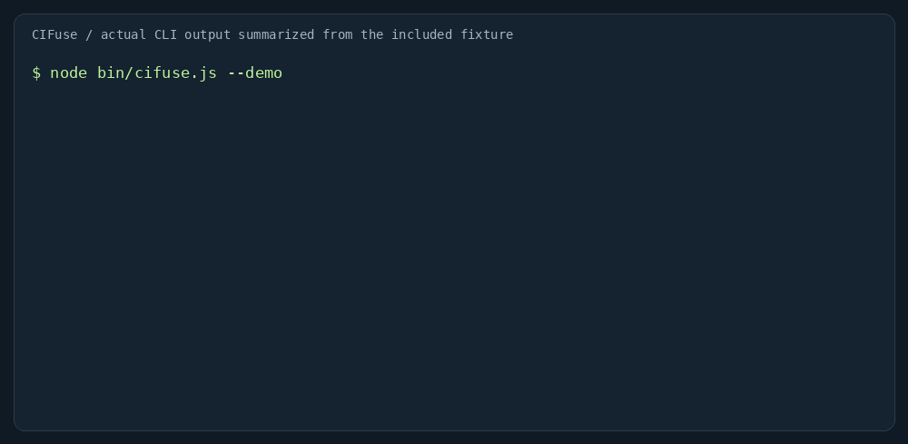

# CIFuse

**Turn noisy CI logs into grouped failures, exact evidence and an investigation plan.**

[Try the workbench](https://brunnojob.github.io/cifuse/) · [Português](README.pt-BR.md) · [Contribute](CONTRIBUTING.md) · [Limitations](docs/LIMITATIONS.md)



[](https://github.com/brunnojob/cifuse/actions/workflows/ci.yml)
[](https://github.com/brunnojob/cifuse/actions/workflows/pages.yml)

A failed build often means scrolling through the same errors, copying evidence into an issue, and checking whether the failure happened before. CIFuse automates that triage in your terminal, browser or GitHub job summary.

```sh
npx --yes github:brunnojob/cifuse --demo
```

Requires Node.js 22+ and Git for the GitHub install. The initial install downloads source; log analysis makes no network requests. No npm registry release is required.

```sh
npx --yes github:brunnojob/cifuse build.log --format json > report.json
npx --yes github:brunnojob/cifuse next.log --baseline report.json --fail-on new
```

- Groups repeated diagnostics with file and line evidence.
- Recognizes 12 pattern families across dependencies, compilers, tests and infrastructure.
- Compares reports for new, existing and resolved signatures.
- Exports JSON and Markdown; supports English and Brazilian Portuguese.
- Runs offline after loading. No backend, account, AI key or runtime dependencies.
- Redacts common credential formats from reports, including surrounding context. This is best effort, **not a secret scanner**.

## What it actually does

The included illustrative fixture contains 8 matching lines grouped into 5 signals. Open the workbench and click **Load example**, or run `npm run demo`. Expand any result to inspect its original context.

CIFuse matches deterministic patterns. It suggests where to investigate; it does not prove root causes, repair code, identify flaky tests, or replace your test exit status. Compared with `grep`, it adds grouping, source locations, baseline comparison and portable reports. Compared with an LLM tool, it needs no model or external log submission. See [design and tradeoffs](docs/ARCHITECTURE.md).

## GitHub Action

Capture an existing command's output and keep its original failure status. Run CIFuse afterwards:

```yaml
steps:
  - uses: actions/checkout@v4
  - uses: actions/setup-node@v4
    with:
      node-version: '22'
  - name: Test and capture log
    shell: bash
    run: |
      set -o pipefail
      npm test 2>&1 | tee build.log
  - name: Summarize failure evidence
    if: ${{ !cancelled() && hashFiles('build.log') != '' }}
    uses: brunnojob/cifuse@main
    with:
      log: build.log
      lang: en
```

The Action appends the report to the job summary. It reads one local text file and does not fetch private workflow logs or post comments. Pin a reviewed commit SHA in production instead of the moving `main` branch. `baseline` accepts a previous JSON report; `fail-on` accepts `findings` or `new` (the latter requires a baseline). No additional token permissions are needed beyond the checkout's `contents: read`.

## CLI

```sh
node bin/cifuse.js build.log another.log --lang pt-BR
cat build.log | node bin/cifuse.js - --format json
node bin/cifuse.js build.log --fail-on findings
```

Exit codes: **0** analysis completed, **1** selected threshold matched, **2** invalid arguments or input. Default behavior is reporting only. Limits: 100 files / 5 MiB combined, 10 retained locations per group. Analysis uses in-memory text logs, not ZIP archives. Large or compressed logs must be split or decoded first.

## Run and contribute

```sh
git clone https://github.com/brunnojob/cifuse.git
cd cifuse
npm test
npm run build
```

Serve `dist/` with any static server to try the website locally. Both browser and CLI import `src/engine.js`; the website defaults to English and offers a persistent PT-BR language switch. Only the language preference is stored; logs and reports are not persisted by the application.

Start with [CONTRIBUTING.md](CONTRIBUTING.md), the [rule catalog](docs/RULES.md), or issues labelled `good first issue`. Sanitized real-world fixtures are especially useful. [Launch material](docs/LAUNCH.md) is ready to adapt for a community post.

Created by [Brunno](https://github.com/brunnojob). MIT licensed. If this saves you time, a star helps others find it.
