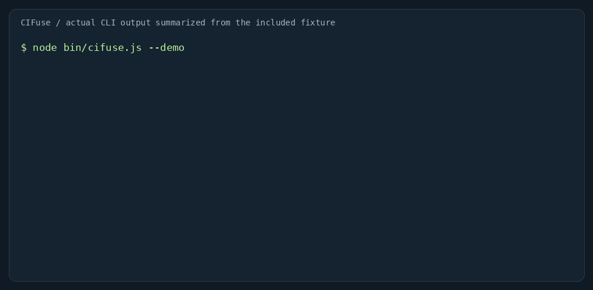

# CIFuse

**Transforme logs extensos de CI em falhas agrupadas, evidências exatas e um plano de investigação.**

[Experimentar no navegador](https://brunnojob.github.io/cifuse/) · [English](README.md) · [Como contribuir](CONTRIBUTING.md)



Seu build falhou e você precisa ler erros repetidos, copiar evidências e verificar se a falha já existia. O CIFuse automatiza essa triagem no terminal, no navegador e no resumo do GitHub Actions.

```sh
npx --yes github:brunnojob/cifuse --demo --lang pt-BR
```

Requer Node.js 22+ e Git para a instalação via GitHub. A instalação baixa o código; a análise não faz requisições de rede.

```sh
npx --yes github:brunnojob/cifuse build.log --format json > anterior.json
npx --yes github:brunnojob/cifuse novo.log --baseline anterior.json --fail-on new
```

- Agrupa diagnósticos repetidos com contagem, arquivo, linha e contexto.
- Reconhece 12 famílias de padrões de compilação, dependências, testes e infraestrutura.
- Compara assinaturas novas, existentes e resolvidas entre relatórios.
- Exporta JSON e Markdown, com interface e relatórios em inglês ou PT-BR.
- Funciona offline após carregar, sem backend, conta ou chave de IA.

O relatório contém padrões reconhecidos e sugestões de investigação, não causas comprovadas. Não corrige código nem identifica testes instáveis. Oculta credenciais comuns por melhor esforço; revise os relatórios antes de compartilhar. Nenhum sinal encontrado não significa que o build passou.

Limites: até 100 arquivos e 5 MiB no total, com até 10 localizações por grupo. Códigos de saída: 0 para conclusão, 1 para o limite selecionado e 2 para erro de entrada. Sem `--fail-on`, apenas gera o relatório.

A integração reutilizável com GitHub Actions está no [README em inglês](README.md#github-action). Use `lang: pt-BR` para o resumo traduzido. A demonstração incluída é ilustrativa, não um benchmark nem resultado medido em um projeto de terceiros.

```sh
git clone https://github.com/brunnojob/cifuse.git
cd cifuse
npm test
npm run build
```

A interface começa em inglês e permite alternar para PT-BR. Apenas a preferência de idioma é persistida; os logs ficam na memória. Criado por [Brunno](https://github.com/brunnojob), sob licença MIT. Contribuições com logs reais sem dados sensíveis são bem-vindas.
